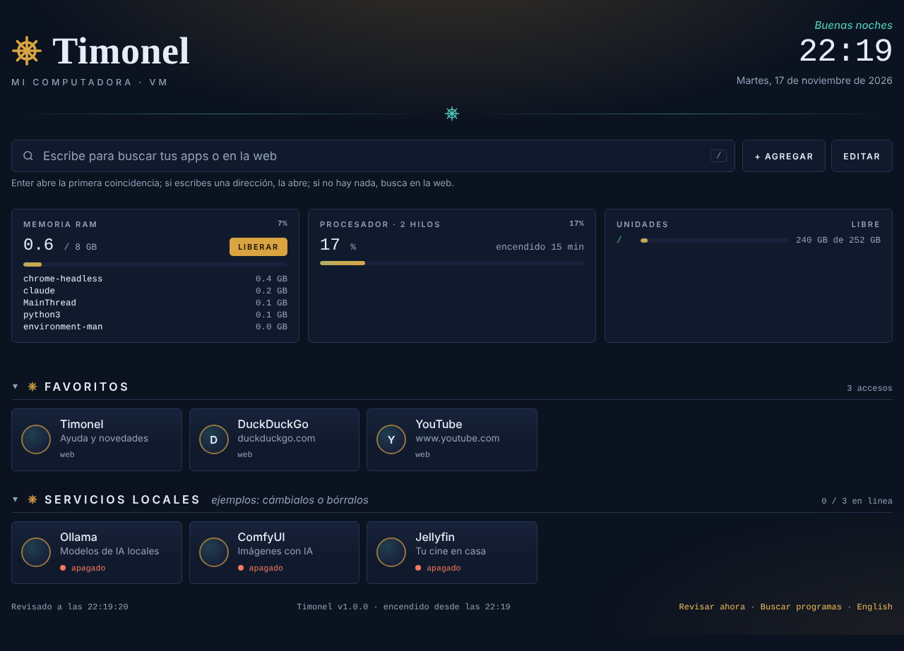

# Timonel

**Un tablero para las apps y servicios de tu propia computadora.** Una página que abre tus sitios, arranca tus programas, te dice qué servicios locales están encendidos y muestra tu memoria, procesador, GPU y discos. Sin Docker, sin base de datos y sin cuenta: un solo archivo de Python y una configuración en JSON.

[Read in English](README.md)



## Por qué Timonel

- **Tu PC, no un servidor.** Arranca una app local (ComfyUI, Ollama, un script, un juego) con un clic. Si es una app web, Timonel espera a que responda y te la abre.
- **También la detiene.** El mismo botón apaga lo que arrancaste: un script para detenerlo, un servicio o el programa que escucha en ese puerto.
- **Sabe qué está encendido.** Los servicios vigilados muestran en línea, apagado o "puerto ocupado por otra app", con latencia y un pequeño historial. Si quieres, te avisa con una notificación cuando uno se cae.
- **Libera memoria.** Un botón descarga los modelos de Ollama, suelta la caché de ComfyUI y compacta los procesos inactivos (en Windows).
- **Se edita sin tocar el JSON.** Agrega, edita, arrastra para reordenar y quita accesos desde la página. El JSON sigue ahí cuando lo quieras.
- **Español e inglés.** La página, los mensajes y hasta las claves de la configuración funcionan en cualquiera de los dos.
- **Privado de entrada.** Solo escucha en `127.0.0.1`, rechaza peticiones de otros sitios y nunca manda contraseñas ni claves de API al navegador.

## Para empezar

Necesitas **Python 3.8 o más nuevo** ([python.org](https://www.python.org/downloads/)). No hay que instalar nada más.

1. Descarga este repositorio (botón verde **Code** › **Download ZIP**) y descomprímelo donde quieras.
2. Arráncalo:
   - **Windows:** doble clic en `Timonel.bat`
   - **macOS:** doble clic en `Timonel.command` (la primera vez: clic derecho › Abrir)
   - **Linux:** `./timonel.sh`
3. Tu navegador abre `http://localhost:3000`. La primera vez se crea `config.json` con ejemplos en el idioma de tu sistema. Cámbialos o bórralos.

Para que Timonel arranque al iniciar sesión:

```sh
python timonel.py --autostart on     # off para quitarlo
```

Otras opciones: `--no-browser`, `--version`, `--help`.

## La configuración

Todo vive en `config.json`, junto a `timonel.py`. Las claves pueden ir en español o en inglés, y Timonel lo guarda en el mismo idioma. Los cambios se toman en cuanto guardas el archivo. Si el JSON tiene un error, la página te dice la línea y la columna, y sigue usando la última versión buena.

Pon esta línea al principio y VS Code te autocompleta y te avisa de errores:

```json
"$schema": "./config.schema.json",
```

Un ejemplo corto:

```json
{
  "idioma": "auto",
  "titulo": "Mi computadora",
  "buscador": "https://duckduckgo.com/?q=",
  "barra": [{ "tipo": "saludo", "nombre": "Ana" }, { "tipo": "reloj" }, { "tipo": "sistema" },
            { "tipo": "clima", "lugar": "Monterrey", "lat": 25.67, "lon": -100.31 }],
  "grupos": [
    { "nombre": "IA", "items": [
      { "id": "comfyui", "nombre": "ComfyUI", "url": "http://127.0.0.1:8188",
        "lanzar": "C:\\IA\\ComfyUI\\run_nvidia_gpu.bat", "vigilar": true, "avisar": true },
      { "id": "ollama", "nombre": "Ollama", "url": "http://127.0.0.1:11434",
        "vigilar": true, "contiene": "ollama", "liberar": "ollama" }
    ]},
    { "nombre": "Enlaces", "pestana": "Diario", "items": [
      { "id": "correo", "nombre": "Correo", "url": "https://correo.ejemplo.com", "icono": "mdi-email-outline" }
    ]}
  ]
}
```

### Accesos (`items`)

| Clave | Qué hace |
| --- | --- |
| `id` | Único y obligatorio. |
| `nombre`, `desc` | Lo que se ve en la tarjeta. |
| `url` | La abre. Con `vigilar: true`, Timonel revisa si responde. |
| `lanzar` | Programa, script, `.app` o `.desktop` que se arranca. Junto con `url`: lo arranca, espera y abre la página. Acepta variables como `%USERPROFILE%` o `~`. |
| `buscar` | Nombres de archivo para buscarlo en tus discos si `lanzar` cambia de lugar (por ejemplo `["ComfyUI.exe"]`). |
| `archivo` | Una página `.html` local, servida por Timonel junto con su carpeta. |
| `servicio` | Un servicio de Windows o una unidad de systemd para iniciar y detener. |
| `detener` | Un script que detiene el programa. Sin él, Detener cierra lo que escuche en el puerto. |
| `vigilar`, `contiene`, `revisar`, `ping` | Revisiones de estado: que responda, un texto que debe aparecer, otra dirección para revisar o un equipo al que hacer ping. |
| `avisar` | Notificación cuando se cae o vuelve. `"avisos": "todos"` arriba la activa para todos los vigilados. |
| `liberar` | `ollama` o `comfyui`: qué hace el botón **Liberar** con él. |
| `icono` | `mdi-nombre` ([Material Design Icons](https://pictogrammers.com/library/mdi/)), `si-nombre` ([Simple Icons](https://simpleicons.org); agrega `-#hex` para un color), la URL de una imagen o un archivo de la carpeta `iconos` (`/iconos/mio.png`). Sin él, el ícono del sitio. |
| `widget` | Números de la API de una app en la tarjeta. Ver abajo. |

### Grupos

`nombre`, `items`, `grupos` anidados, `pestana` (pone el grupo en una pestaña), `estilo: "columna"`, `columnas`, `compacto`, `colapsado`, `icono`, `nota`.

### Barra de arriba (`barra`)

`saludo`, `reloj`, `sistema` (memoria, procesador, GPU NVIDIA, discos y procesos que más gastan), `clima` (de [Open-Meteo](https://open-meteo.com), sin clave) y widgets `api`.

### Widgets de API

Muestran los números de cualquier API JSON en una tarjeta o en la barra. Las claves se quedan en tu computadora: ponlas en `proveedores` (o léelas de un archivo con `claveDesde`) y llámalas por su nombre.

```json
"proveedores": { "sonarr": { "claveDesde": "C:\\ProgramData\\Sonarr\\config.xml", "cabeceraClave": "X-Api-Key" } },
...
{ "id": "sonarr", "nombre": "Sonarr", "url": "http://127.0.0.1:8989", "vigilar": true,
  "widget": { "tipo": "api", "proveedor": "sonarr",
    "consultas": [{ "url": "http://127.0.0.1:8989/api/v3/wanted/missing?pageSize=1",
                    "mapeo": { "Faltan": "totalRecords" } }],
    "resaltar": { "Faltan": [{ "cuando": ">", "valor": 0, "nivel": "aviso" }] } } }
```

También hay: `lista` (filas de un arreglo), `formatos` (`bytes`, `fecha`), `{hoy}`, `{en7dias}`, `{ayer}` y `{hace7dias}` dentro de las URL, y widgets `qbittorrent` e `iframe`.

### Apariencia

`"tema": { "paleta": "noche" }` (o `claro`, o `auto` para seguir al sistema). También `encabezado`, `tarjeta` y una imagen de `fondo` con `blur`, `brillo` y `opacidad`. Para todo lo demás, crea `custom.css` o `custom.js` junto a `timonel.py`.

Referencia completa: [`config.schema.json`](config.schema.json) (claves en inglés: [`config.schema.en.json`](config.schema.en.json)).

## Teclado

`/` o empieza a escribir para buscar. **Enter** abre la primera coincidencia, abre la dirección que escribiste o busca en la web.

## Asistentes de IA (MCP)

Timonel puede conectarse con Claude, Cursor y otros clientes MCP para que lean tu tablero o agreguen accesos. Está apagado hasta que lo enciendas:

```json
"mcp": { "activo": true, "escritura": false }
```

La dirección es `http://127.0.0.1:3000/api/mcp`, con el token de `mcp_token.txt` como Bearer. Herramientas: `read_config`, `validate_config`, `service_status`, `add_shortcut` y `remove_shortcut`. Las dos últimas necesitan `"escritura": true`.

## Privacidad

Timonel solo escucha en tu computadora. La página solo carga cosas de fuera en estos casos:

- los íconos de [jsDelivr](https://www.jsdelivr.com), si usas íconos `mdi-` o `si-`;
- el ícono de cada sitio desde DuckDuckGo, si un acceso no tiene ícono;
- el clima de Open-Meteo, si agregas el widget de clima.

Si prefieres evitar todo eso, usa íconos locales en la carpeta `iconos`.

## Qué funciona en cada sistema

| | Windows | macOS | Linux |
| --- | --- | --- | --- |
| Accesos, estados, búsqueda y edición | ✓ | ✓ | ✓ |
| Iniciar y detener programas | ✓ | ✓ | ✓ |
| Memoria, procesador, discos y procesos | ✓ | ✓ | ✓ |
| GPU NVIDIA | ✓ | — | ✓ |
| Notificaciones | ✓ | ✓ | ✓ (`notify-send`) |
| Servicios | ✓ | — | ✓ (systemd) |
| Compactar procesos inactivos al liberar | ✓ | — | — |

## Pruebas

```sh
pip install playwright && python -m playwright install chromium
python -m unittest tests/test_timonel.py -v
```

Son 54 pruebas: cada flujo en un navegador de verdad contra servicios locales falsos, más revisiones de seguridad (otros sitios, otros hosts, salirse de la carpeta y que no lleguen secretos al navegador). Pon en `AXE_JS` la ruta de `axe.min.js` para agregar una revisión de accesibilidad.

## Licencia

[MIT](LICENSE). Hecho por [VEGA2099](https://github.com/VEGA2099).
