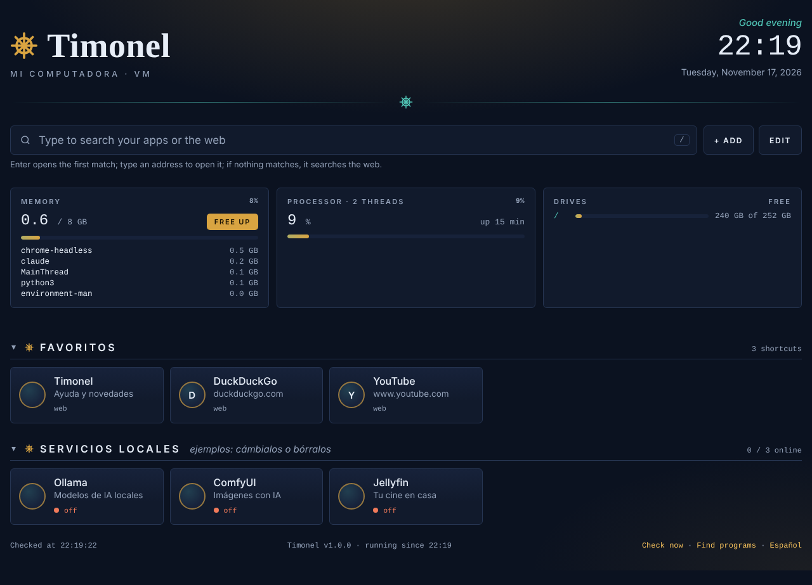

# Timonel

**A dashboard for the apps and services on your own computer.** One page that opens your sites, starts your programs, tells you which local services are running, and shows your memory, CPU, GPU and drives. No Docker, no database, no account: a single Python file and a JSON config.

[Leer en español](README.es.md)



## Why Timonel

- **Your PC, not a server.** Start a local app (ComfyUI, Ollama, a script, a game) with one click. If it's a web app, Timonel waits until it answers and opens it for you.
- **Stop it, too.** The same button stops what you started: a stop script, a service, or the program listening on that port.
- **Knows what's up.** Watched services show online / off / "port taken by another app", with latency and a small history. Optional desktop notifications when one goes down.
- **Frees memory.** One button unloads Ollama models and ComfyUI's cache and trims idle processes (Windows).
- **Edit without touching JSON.** Add, edit, drag to reorder and remove shortcuts from the page. The JSON is still there when you want it.
- **Spanish and English.** The page, the messages and even the config keys work in either language.
- **Private by default.** Listens on `127.0.0.1` only, refuses requests from other sites, never sends passwords or API keys to the browser.

## Quick start

You need **Python 3.8 or newer** ([python.org](https://www.python.org/downloads/)). Nothing else to install.

1. Download this repository (green **Code** button › **Download ZIP**) and unzip it anywhere.
2. Start it:
   - **Windows:** double-click `Timonel.bat`
   - **macOS:** double-click `Timonel.command` (the first time: right-click › Open)
   - **Linux:** `./timonel.sh`
3. Your browser opens `http://localhost:3000`. The first run creates `config.json` with examples in your system's language. Change them or delete them.

To start Timonel when you log in:

```sh
python timonel.py --autostart on     # off to undo
```

Other options: `--no-browser`, `--version`, `--help`.

## The config file

Everything lives in `config.json`, next to `timonel.py`. You can write the keys in English or in Spanish, and Timonel saves it back in the same language. Edits are picked up as soon as you save the file. If the JSON has a mistake, the page tells you the line and column and keeps using the last good version.

Add this line at the top to get autocomplete and checks in VS Code:

```json
"$schema": "./config.schema.en.json",
```

A small example:

```json
{
  "language": "auto",
  "title": "My computer",
  "searchEngine": "https://duckduckgo.com/?q=",
  "bar": [{ "type": "greeting", "name": "Ana" }, { "type": "clock" }, { "type": "system" },
          { "type": "weather", "place": "Lisbon", "lat": 38.72, "lon": -9.14 }],
  "groups": [
    { "name": "AI", "items": [
      { "id": "comfyui", "name": "ComfyUI", "url": "http://127.0.0.1:8188",
        "launch": "C:\\AI\\ComfyUI\\run_nvidia_gpu.bat", "watch": true, "notify": true },
      { "id": "ollama", "name": "Ollama", "url": "http://127.0.0.1:11434",
        "watch": true, "contains": "ollama", "freeMemory": "ollama" }
    ]},
    { "name": "Links", "tab": "Daily", "items": [
      { "id": "mail", "name": "Mail", "url": "https://mail.example.com", "icon": "mdi-email-outline" }
    ]}
  ]
}
```

### Shortcuts (`items`)

| Key | What it does |
| --- | --- |
| `id` | Unique, required. |
| `name`, `description` | Shown on the card. |
| `url` | Opens it. With `watch: true`, Timonel checks whether it answers. |
| `launch` | Program, script, `.app` or `.desktop` to start. Combined with `url`: starts it, waits, opens the page. Environment variables like `%USERPROFILE%` or `~` work. |
| `find` | List of file names to look for on your drives if `launch` moves (e.g. `["ComfyUI.exe"]`). |
| `file` | A local `.html` page, served through Timonel with its folder. |
| `service` | A Windows service or a systemd unit to start and stop. |
| `stop` | A script that stops the program. Without it, the Stop button ends whatever listens on the port. |
| `watch`, `contains`, `check`, `ping` | Status checks: answer, text that must appear, a different address to check, or a host to ping. |
| `notify` | Desktop notification when it goes down or comes back. `"alerts": "all"` at the top turns it on for every watched shortcut. |
| `freeMemory` | `ollama` or `comfyui`: what the **Free up** button does with it. |
| `icon` | `mdi-name` ([Material Design Icons](https://pictogrammers.com/library/mdi/)), `si-name` ([Simple Icons](https://simpleicons.org), add `-#hex` for a colour), an image URL, or a file in the `iconos` folder (`/iconos/mine.png`). Without it, the site's favicon. |
| `widget` | Numbers from an app's API on the card. See below. |

### Groups

`name`, `items`, nested `groups`, `tab` (put the group on a tab), `style: "column"`, `columns`, `compact`, `collapsed`, `icon`, `note`.

### Top bar (`bar`)

`greeting`, `clock`, `system` (memory, CPU, GPU on NVIDIA, drives, top processes), `weather` (from [Open-Meteo](https://open-meteo.com), no key needed), and `api` widgets.

### API widgets

Show any JSON API's numbers on a card or in the bar. Keys stay on your computer: put them in `providers` (or read them from a file with `keyFrom`) and refer to them by name.

```json
"providers": { "sonarr": { "keyFrom": "C:\\ProgramData\\Sonarr\\config.xml", "keyHeader": "X-Api-Key" } },
...
{ "id": "sonarr", "name": "Sonarr", "url": "http://127.0.0.1:8989", "watch": true,
  "widget": { "type": "api", "provider": "sonarr",
    "queries": [{ "url": "http://127.0.0.1:8989/api/v3/wanted/missing?pageSize=1",
                  "mapping": { "Missing": "totalRecords" } }],
    "highlight": { "Missing": [{ "when": ">", "value": 0, "level": "warning" }] } } }
```

Also: `list` (rows from an array), `formats` (`bytes`, `date`), `{today}` / `{in7days}` / `{yesterday}` / `{7daysago}` in URLs, `qbittorrent` and `iframe` widgets.

### Look

`"theme": { "palette": "night" }` (or `light`, or `auto` to follow your system). Also `header`, `card`, a `background` image with `blur`, `brightness` and `opacity`. For anything else, create `custom.css` or `custom.js` next to `timonel.py`.

Full reference: [`config.schema.en.json`](config.schema.en.json) (Spanish keys: [`config.schema.json`](config.schema.json)).

## Keyboard

`/` or just start typing to search. **Enter** opens the first match, opens an address you typed, or searches the web.

## AI assistants (MCP)

Timonel can talk to Claude, Cursor and other MCP clients so they can read your dashboard or add shortcuts. It's off until you turn it on:

```json
"mcp": { "active": true, "write": false }
```

The endpoint is `http://127.0.0.1:3000/api/mcp` with the token from `mcp_token.txt` as a Bearer token. Tools: `read_config`, `validate_config`, `service_status`, `add_shortcut`, `remove_shortcut` (the last two need `"write": true`).

## Privacy

Timonel only listens on your own computer. The page loads things from outside in these cases only:

- icons from [jsDelivr](https://www.jsdelivr.com), if you use `mdi-` or `si-` icons;
- site favicons from DuckDuckGo, if a shortcut has no icon;
- the weather from Open-Meteo, if you add the weather widget.

Use local icons in the `iconos` folder if you'd rather avoid all of them.

## What works where

| | Windows | macOS | Linux |
| --- | --- | --- | --- |
| Shortcuts, status, search, editing | ✓ | ✓ | ✓ |
| Start / stop programs | ✓ | ✓ | ✓ |
| Memory, CPU, drives, processes | ✓ | ✓ | ✓ |
| NVIDIA GPU | ✓ | — | ✓ |
| Notifications | ✓ | ✓ | ✓ (`notify-send`) |
| Services | ✓ | — | ✓ (systemd) |
| Trimming idle processes on Free up | ✓ | — | — |

## Tests

```sh
pip install playwright && python -m playwright install chromium
python -m unittest tests/test_timonel.py -v
```

54 tests: every flow in a real browser against fake local services, plus security checks (other sites, other hosts, path traversal, no secrets in the browser). Set `AXE_JS` to the path of `axe.min.js` to add an accessibility scan.

## License

[MIT](LICENSE). Made by [VEGA2099](https://github.com/VEGA2099).
